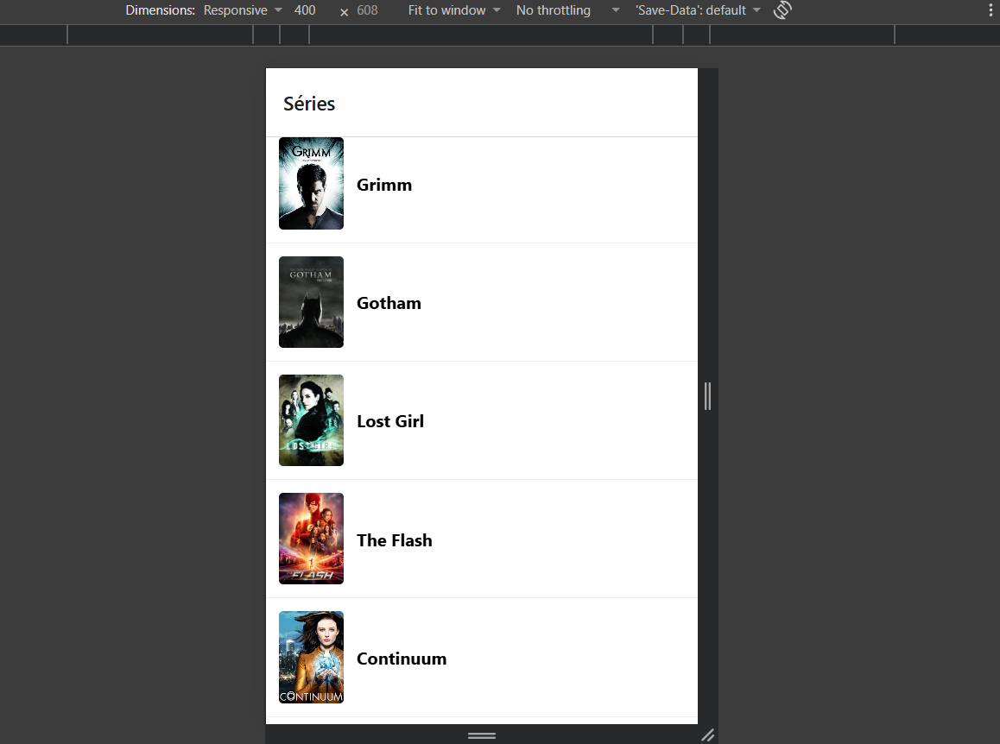
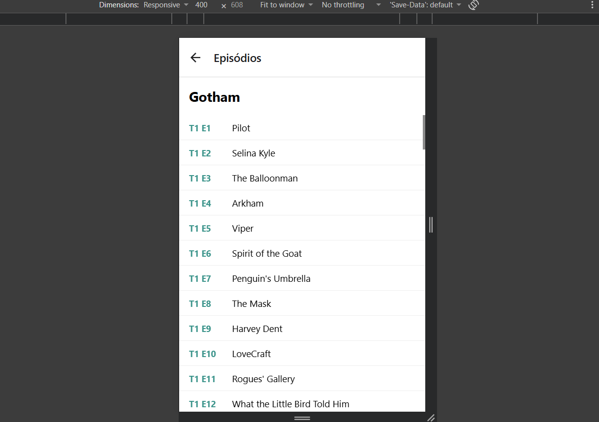

# Séries TVmaze - Checkpoint 3 - Cross-Platform Application Development.

- **Séries** (`screens/SeriesScreen.js`): lista as séries de `https://api.tvmaze.com/shows` com imagem e nome. Séries sem imagem (`image: null`) mostram um quadro cinza.
- **Episódios** (`screens/EpisodiosScreen.js`): recebe o `id` da série por `route.params` e lista temporada, número e nome dos episódios de `https://api.tvmaze.com/shows/${id}/episodes`.

Navegação com `@react-navigation/native-stack`, listas com `FlatList` e dados buscados com `fetch` dentro de `useEffect` (async/await com try/catch/finally). As duas telas mostram um `ActivityIndicator` enquanto carregam e uma mensagem se der erro.

## Prints

| Séries | Episódios |
|---|---|
|  |  |
